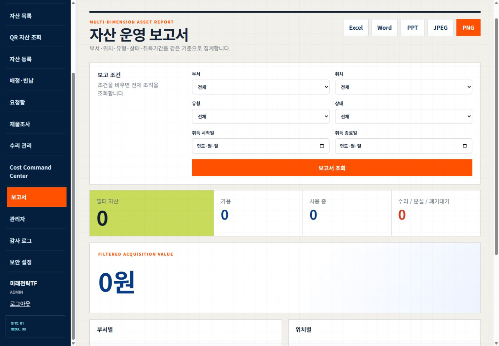
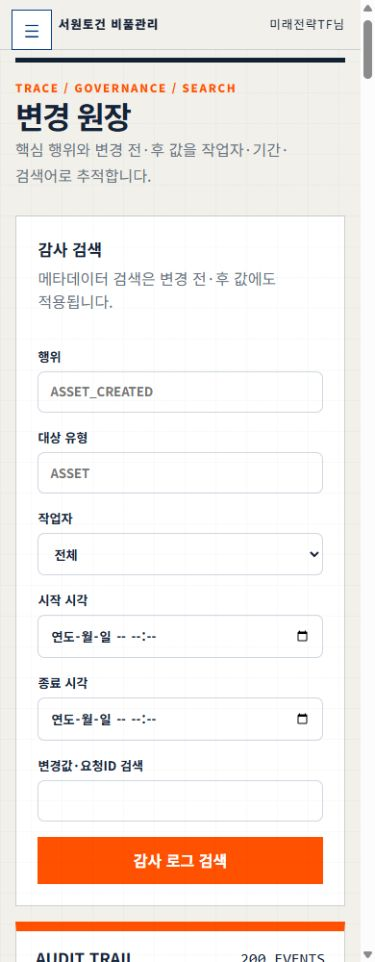

# 전체 메뉴 PC·모바일 배치 점검

2026-10-17 KST. **요청한 반응형 배치 수정·운영 반영 완료**. 업무 규칙·계정·DB 변경은 하지 않았다. P7 운영 인수 전체 상태는7/8 그대로다.

## 발견·수정

| 결함 | 실제 근거 | 수정 |
|---|---|---|
| 관리자 조직·초대 카드 내부 잘림 | PC 카드553px 안의 내용1003px, 초대 입력 오른쪽1813px | 작은 카드 안의 폼을 세로 배치·2열로 정리, 필드 최소폭0 |
| 감사 검색 폼 잘림 | 모바일 카드341px 안의 내용581px·작업자 선택지 기본폭536px | grid/label 최소폭0, input/select/textarea 폭100%, 모바일1열 |
| 요청·관리자 숨김 탭 동시 노출 | hidden 속성이 있는 패널의 실제 display가 grid | view-root 내부 [hidden]을 실제 display:none으로 고정 |
| 요청함 발주·입고·검수 중첩 배치 | 240px 열 안의 workflow-shell 최소폭320px | 외곽 단일열, 내부 PC3열/작은 화면1열 및 테이블 분리 |
| 보고서 금액 카드 여백 없음 | padding0·첫 문구가 테두리에서1px | 16~24px 내부 여백 |
| 파일·기준정보·안내 텍스트 | 모바일 파일 입력 내부5px 넘침, 기준정보 PC 폼243px 안 내용최대686px | 파일폭 제한, 기준정보 폼1열·카드 여백, 한국어 어절 우선 줄바꿈 |

기존 표의 `.table-wrap` 내부 가로 스크롤은 그대로 유지했다. `overflow:hidden`으로 결함을 숨겨 PASS 처리하지 않고 문서 경계·카드 경계·내부 scrollWidth를 별도로 관찰했다.

## 메뉴별 체크리스트

| 주 메뉴 | PC1440px | 모바일390px |
|---|---|---|
| 대시보드 | PASS | PASS |
| 내 비품 | PASS | PASS |
| 자산 목록 | PASS | PASS |
| QR 자산 조회 | PASS | PASS |
| 자산 등록 | PASS | PASS |
| 배정·반납 | PASS | PASS |
| 요청함 | PASS | PASS |
| 재물조사 | PASS | PASS |
| 수리 관리 | PASS | PASS |
| Cost Command Center | PASS | PASS |
| 보고서 | PASS | PASS |
| 관리자 | PASS | PASS |
| 감사 로그 | PASS | PASS |
| 보안 설정 | PASS | PASS |

- [x] 위28화면의 여백·줄바꿈·일반 영역 넘침·필드 경계·오류 화면 여부 검사.
- [x] 관리자4탭×2폭, 요청함3탭×2폭 추가14화면. 기준정보6개 폼도 펼쳐 검사, 비선택 hidden 노출0.
- [x] 관리자·감사·요청·등록·보고서의1024/768px 추가10화면. 총52화면 일반 문서/폼 잘림·넘침0.
- [x] 운영 API가 없는 loopback 합성 fixture에서 긴 선택지·날짜·파일·금액·숨김 패널을1440/1024/768/390/360px 검증. Tab 이동과3px focus outline 확인.
- [x] 구문502개, 단위1031 PASS/0 FAIL/8 SKIP, UI47 PASS, 집중4 PASS. GitHub quality[38989593591](https://github.com/visionlab-coder/sqcm-i-inventory-system/actions/runs/38989593591)의 unit·three-tier-integration SUCCESS.
- [x] 같은 SHA `63aed8b6a58bbb00e1359fc81d1d6f7c214a7e2b`의 불변 frontend 이미지 반영·healthy 및 공개 smoke PASS. backend/database ID 불변·host port0, 서비스3개 healthy. Inventory/SQCM-i 연결 각4, SQCM-i OS200·safe-link301 보존.
- [x] 조작 스킬·QR 소비 스킬·등록부·현재 상태·기계 증거·캡처 동기화. 실행 계약 strict8/8·경고0. 범위를 분리한2개 기능 영향검사 IMPACT_PLANNED.

## 캡처·검증 경계

현재 로그인된 ADMIN 세션의 화면을 사용했고 빈 자산 원장과 현재 제공된 데이터 상태를 검사했다. 실제 업무 제출·파일 업로드·초대·MFA·계정 변경·카메라 허용·자산 생성은0건이다. 다른 역할·실제 직원 업무·모든 데이터/오류 상태·전체 WCAG 자동검사는 NOT_RUN이며 배치 PASS를 이들 UAT 완료로 승격하지 않는다.

skill-creator의 Python quick_validate는 PyYAML 부재로 실행 실패했다. 설치·전역 환경 변경을 하지 않고 단순 frontmatter·참조·명령을 직접 검토했다. 기존 업로드 기능 등록부의 legacy 상태 오류는 이번 범위 밖으로 보존했으며 전체 registry PASS가 아닌 UI/QR2개 기능의 한정 영향검사만 기록한다.

운영 runtime RELEASE_TAG는 새 frontend SHA이며 backend는 종전 `1e0f9145e1f4e93f9d7b7485319a33815c159321` 실행을 유지한다. 공통 tag를 위한 backend 호환 이미지는 빌드만 했다. 실패 복귀는 이전 frontend `0c7ba0cb001bc1123860dab834a33bb857a92ffe`로 같은 Compose의 frontend만 교체하는 경로이며 실제 rollback·DB복원은 NOT_RUN이다. 사용자 소유 기존 dirty4개는 Git에 포함하지 않았다. 체크포인트 내역은 이 보고서를 포함한 후속 증거 commit에 남긴다.

기계 근거: `agent docs/harness/UI_LAYOUT_AUDIT_20261017_EVIDENCE.json` (수정 전28·수정 후52화면 및 합성5폭의 비식별 DOM 수치). 임시 viewport를 복구했다. CSS 캐시 버전은 `20261017-layout-audit`다.
