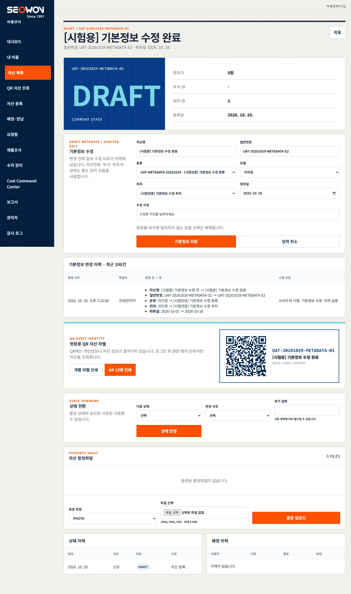

# 자산 기본정보 수정 — 구현·배포·실제 브라우저 검증

2026-10-29 KST. **요청 기능 운영 반영 및 시험 자산 브라우저 검증 PASS**. 전체 제품/P7 완료 판정은 아니며 P7은 7/8 유지한다.

## 7범주 완료 체크리스트

- [x] 요구·권한: 현재 사용자의 Inventory 운영 배포 및 시험 자산 등록·기본정보 수정·조회·이력 확인 승인. 직원 계정과 실제 업무 데이터 변경 금지.
- [x] 구현·데이터: 이름/일련번호/분류/모델/위치/취득일의 명시적 allowlist, 기존 audit_logs 재사용. schema migration 없음.
- [x] 보안·동시성: ADMIN/MANAGER 권한 및 조직·부서 재검사, CSRF·멱등성 유지, 활성/같은 조직 기준정보·모델분류 일치, xmin 낙관적 버전·행 잠금·감사 원자성.
- [x] 로컬·CI: 전체 단위1044 PASS·8 SKIP·0 FAIL, 집중17 PASS·UI 계약47 PASS. 동일 후보 GitHub-hosted unit 및 three-tier-integration SUCCESS.
- [x] 배포·복귀: SHA 이미지2개와 승인 대상 확인, config/precheck/health/readiness/익명401/로고 smoke PASS. 이전 정상 이미지 보존, DB와 migration 무변경. 실제 rollback은 미실행.
- [x] 실제 화면·DB: 브라우저 등록→5필드 수정→전후 이력→입력 취소→새로고침→표식 검색→상세 재조회 PASS. PC1440/모바일390 편집 폼 가로 넘침0, 전용 이력 테이블은 가로 스크롤 사용. 독립 운영 DB/USER403 일치.
- [x] 정리·인계: 시험 자산 취소·시험 기준정보 비활성화, 기존 데이터 지문 대조, 사람/기계 증거·현재 상태·기능/스킬 등록부 갱신 및 exact allowlist Git 복구 체크포인트.

## 구현과 판정 범위

`src/services/asset-metadata-service.js`가 필드 검증과 트랜잭션을 소유하고 PATCH `/api/enterprise/assets/:id`가 이를 호출한다. 상세 GET에서 같은 권한 범위 안의 최근100건 기본정보 이력을 제공한다. 성공 감사에는 변경 전후·사유·작업자·시각을 저장하고, 감사 실패 시 asset UPDATE도 rollback한다. 이름 외에 사용자가 요청한 분류·위치·취득일을 실제로 수정했다. 모델 필드는 구현·단위/통합 검사했으나 모델 기준정보가 없는 운영에서 모델 변경 브라우저 시험은 NOT_RUN이다.

USER403, 미인증401, 타 조직·부서403, 비활성/다른 조직 기준정보400, 잘못된 날짜400, 허용하지 않은 자산번호·부서·취득가·상태 필드400, 취소/폐기 또는 오래된 버전409, 동일 값 저장400을 검사했다. 격리 실제 PG 통합은 같은 버전의 경쟁 저장에서 한 건200/한 건409와 감사 일치를 검증한다. UI는 저장 중 중복 클릭을 막고 충돌 시 입력을 유지한 뒤 최신 정보 확인을 요구한다. 기존 상태 변경·배정·비용 승인 흐름은 우회하지 않는다.

## 배포 기준선·실제 명령

- 코드/이미지 후보: `e0d2b554b13995718127a2a25c91bb146865af8b`.
- 브랜치: `codex/p7-qs-6-16-0-production-evidence`, origin 동일 SHA 확인.
- [GitHub quality 40821227968](https://github.com/visionlab-coder/sqcm-i-inventory-system/actions/runs/40821227968): unit 및 three-tier-integration SUCCESS.
- backend 이미지 ID `sha256:e796ddab064a8233933f5d2e7be4f282a7f1dc2792aba8d4358360c45dd3a9ab`.
- frontend 이미지 ID `sha256:ded395be9129246cf5a151ad61365cd47556f2ce33ba1dd4e72d4ddcf950c612`.
- `node scripts/deploy-precheck.mjs` + 승인 runtime env reference: 종료0. Secret 원문은 기록하지 않음.
- Production Compose `config --quiet`: 종료0. `up -d --no-deps --no-build --wait --wait-timeout 60 backend`, 이어 frontend: 종료0.
- `DEPLOY_BASE_URL=https://inventory.safe-link.co.kr npm.cmd run deploy:smoke`: 종료0. health200·api health200·readiness200·익명items401·공식로고200.
- `npm.cmd run production:tunnel-watchdog`: 읽기 전용, mutationPerformed=false. Inventory/SQCM-i 연결 각4, Inventory200·SQCM-i OS200·SAFE-LINK301.
- DB 컨테이너 `21cd02e609acdceed47e0aa84aefdcc37149c4b2a6c1998a3ac9d49e93f64a65` 불변. 3서비스 healthy, backend/database host port0, frontend127.0.0.1:3300.
- 기존 backend `sha-1e0f9145e1f4e93f9d7b7485319a33815c159321`와 frontend `sha-63aed8b6a58bbb00e1359fc81d1d6f7c214a7e2b` 보존. 실패 시 각 서비스의 RELEASE_TAG를 이전 정확한 값으로 override하여 같은 Compose `up --no-deps --no-build --wait` 복귀하도록 준비했으나 실행하지 않았다. 복귀 시 runtime RELEASE_TAG도 이전 설정으로 정합화해야 한다. DB 자동 migration/seed는 false 유지.

## 실제 브라우저 증거

Computer Use의 인앱 브라우저에서 화면에 관찰된 입력·버튼으로만 등록·수정했다. API로 자산을 대신 만들거나 수정한 결과를 브라우저 성공으로 승격하지 않았다. 기존 유효 ADMIN 로그인은 교체하지 않았다. 초기 로딩 직후 로그인 폼이 잠시 보였지만 안정화 후 기존 세션이 복원됐으며, 직원 자격증명 입력·로그아웃·계정 설정 변경은 없었다. 시험 credential 입력을 시도한 locator는 필드를 찾지 못해 아무 값도 전달하지 않았고 메모리 참조를 비웠다. 새 브라우저 로그인 자체는 NOT_RUN이다.

| 순서 | 관찰 결과 | 판정 |
|---|---|---|
| 등록 | `UAT-20261029-METADATA-01`, ID9, 이름 `[시험용] 기본정보 수정 전`, S1, 취득일2026-10-01, DRAFT·취득가0 | PASS |
| 수정 | 이름 `[시험용] 기본정보 수정 완료`, 일련번호S2, 시험 전용 분류ID1·위치ID2, 취득일2026-10-28, 사유 입력 후 기본정보 저장 | PASS |
| 이력 | 5필드 전후 값·현재 작업자·2026-10-29 14:15 KST·사유, UI와 DB 감사1건 일치 | PASS |
| 입력 취소 | 미저장 이름을 입력하고 취소, 저장된 이름 복원·추가 감사0 | PASS |
| 영속성 | 전체 새로고침 후 자산 목록에서 고유 번호 검색, 정확히1결과·상세 이름/분류/위치/취득일·이력 유지 | PASS |
| 독립 권한 | 기존 별도 UAT USER HTTP 세션으로 해당 자산 PATCH403, 수정 없이 logout204 | PASS |
| 배치 | PC1440의 문서폭1425, 모바일390의 문서폭375, 편집 입력칸 우측이 화면 내부·콘솔 오류0·viewport 복원 | PASS |

[모바일 캡처](../screenshots/asset-metadata-20261029/mobile.png). 캡처는 시험 종료 전 DRAFT 상태에서 저장 내용과 이력을 관찰한 역사 증거이며 현재 시험 자산은 아래와 같이 취소됐다.

## 시험 정리·기존 데이터 보존

`scripts/production-asset-edit-uat.mjs --baseline` 종료0 → 배포 → `--prepare 20` 종료0 → 브라우저 → `--verify` 종료0 → `--cleanup` 종료0. helper는 시험 전용 분류/위치만 생성하고 자산 생성·기본정보 수정은 하지 않는다. 현재 브라우저 작업자의 ID는 보이는 이름/역할과 읽기 전용 DB의 유일한 ACTIVE ADMIN을 대조해 고정했다. 상태 파일과 자격증명은 저장소 밖 보호 runtime에 있으며 원문 credential/TOTP/cookie/CSRF는 산출물에 없다.

- 최종 시험 자산9: CANCELLED, deactivated=true, 취득가0, 배정0, 기본정보 변경 감사1건 보존.
- 새 시험 분류1: is_active=false. 새 시험 위치2: INACTIVE. 기존 기준정보는 수정하지 않음.
- 파괴 삭제하지 않음. 시험 표식·상태·감사 기록은 실물/실업무에 사용하면 안 됨.
- 배포 전과 시험/정리 후 회사13계정·권한13건의 모든 컬럼 지문 동일. 비밀번호·역할·MFA·상태·명부 변경0.
- 17개 기존 업무 테이블 count/지문 동일. 배제 대상은 이번 고유 시험 자산과 이번 고유 기준정보 code뿐이다. 이전 시험 자산8도 불변이다.
- 별도 UAT 계정의 로그인/세션 기록과 이번 시험 감사·상태 이력·outbox 추가는 허용한 시험 영향이다. 이를 기존 업무 데이터의 무변경 주장과 혼동하지 않는다.
- 보호 listener PID1234/31896·11434/95224·18766/11460 및 cloudflared PID23340/75468·시작시각 동일. 18765 listener는 배포 전후 모두 없었으며 본 작업에서 중단한 것이 아니다. staging 변경0.
- 배포 후 backend 파싱 로그91건에서 error/fatal0, 브라우저 console error0.

## 검증·복구 체크포인트·남은 경계

단위13개 기본정보 시험과 PWA/UI4개 총17 PASS, UI 계약47 PASS, repository hygiene 고정 자격증명/Mock 메타데이터0, diff 공백 오류0. 프롬프트 strict8/8·경고0, 해당 기능/스킬2개/시험2개 scoped 영향 검사 IMPACT_PLANNED 및 실제 브라우저 조작 PASS다. `skill-creator quick_validate.py`는 기존 Python의 PyYAML 미설치로 BLOCKED이며 frontmatter/name/placeholder를 수동 검사했다. 기존 다른 기능의 비표준 상태값이 있는 전체 등록부 검증 PASS는 주장하지 않는다.

실제 운영 rollback·fresh browser login·모델 변경·직원 업무 UAT·P7 최종 운영 인수는 이번 완료 범위가 아니다. 보안·실데이터·권한을 낮추어 이 Gate를 닫지 않았다. 현재 사용자는 **자산 목록 → 상세 → 기본정보 수정 → 사유 입력 → 기본정보 저장 → 변경 이력** 순서로 사용할 수 있다. 새로고침 시 SPA의 최초 화면은 대시보드이며 다시 자산 목록에서 찾는다.

기능 코드 커밋은 위 e0d2b55로 origin에 존재한다. 이 보고서·기계 증거·스킬 및 시험 도우미 보완의 완료 체크포인트는 이 파일을 포함한 후속 Git commit이며 운영 이미지 후보를 그 문서 커밋으로 오인하지 않는다. 사용자 소유 dirty5개는 stage/commit에서 제외한다.
