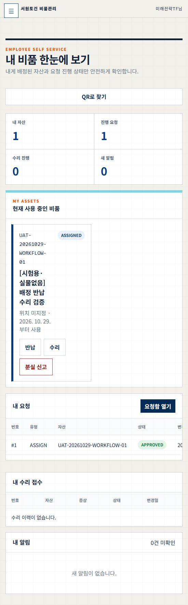

# 배정·반납·수리 요청 실제 브라우저 검증

2026-10-29 KST. **배정 PASS / 수리 접수·진행 PASS / 반납 FAIL, 전체 시나리오 HOLD**. 건강상태200이나 단위시험 통과를 실제 반납 성공으로 대체하지 않는다.

## 계약·정본·보존

현재 사용자는 시험 자산으로만 브라우저 검증하고 기존 직원 계정·실제 데이터를 변경하지 않도록 승인했다. 기준 HEAD `f28b9ad022edb22b173f24dda1b994b3a298adc2`, 실제 frontend/backend 이미지 revision `e0d2b554b13995718127a2a25c91bb146865af8b`. 현재 유효 ADMIN 브라우저 세션을 교체하지 않고 신규 합성 자산10만 생성했다. 요청자는 현재 세션20, 승인자는 기존 별도 UAT ADMIN5이며 자가승인 금지를 유지했다. 시험 자산의 신규 배정으로 내 비품 요약이 잠시 바뀌는 것은 시험 범위이며 직원 계정 행·기존 배정 행 수정은 없다.

정본은 `agent docs/prompts/ASSET_WORKFLOW_BROWSER_20261029.md`, 조작 스킬은 `.agents/skills/sqcm-i-asset-workflow/SKILL.md`다. 도우미는 자산/요청을 API로 대신 만들지 않는다. SQL은 읽기 전용이고 계정 credential·MFA·cookie·CSRF·직원 명부는 산출물에 없다. 기존 dirty5개는 제외한다. 실행은 단일 담당, 모델 설정 inherited/unknown·Laya RULE이며 다른 모델/에이전트는 사용하지 않았다.

## 7범주 체크리스트

- [x] 요청·권한: Inventory 시험 표식과 기존 데이터 보존 범위 고정.
- [x] 기준선: 중복 표식0, 기존 ASSIGN/RETURN/REPAIR 정책 존재, 회사13계정·권한13건과 기존25개 업무/설정 테이블 지문 저장.
- [x] 배정: 브라우저 신규 AVAILABLE 자산 등록·배정 초안/제출, 독립 UAT API 승인, 브라우저 내 비품과 DB 배정 일치.
- [ ] 반납: 브라우저 GOOD·부속품·메모·합성 PNG 입력 및 제출을 시도했으나 사진422로 차단. RETURN DRAFT·반납0·사진0.
- [x] 수리: 브라우저 OPEN 접수→진행 버튼 IN_PROGRESS, DB 동일. 종료 시 소유 시험 수리 건만 CANCELLED·비용null.
- [x] 역조건·보존: 일반 USER 승인403, 비배정 USER self-service 반납403. 매 단계 기존 지문 동일. 관련 단위20 PASS.
- [ ] 완전 정리·인수: 시험 활성 배정1과 반납 초안1이 남아 HOLD. 요청자만 초안 취소가 가능하고 현재 UI에는 초안 재개/취소 경로가 없어 다른 UAT 계정이나 SQL로 우회하지 않았다. 파괴 삭제·배포·서비스 변경0.

## 계층·실제 관찰

| 업무 | 브라우저 | API/서비스·DB | 판정 |
|---|---|---|---|
| 등록 | 태그 `UAT-20261029-WORKFLOW-01`, `[시험용·실물없음] 배정 반납 수리 검증`, 취득가0, AVAILABLE | asset10, created_by20, org1 | PASS |
| 배정 | 배정·반납 메뉴에서 ASSIGN 요청1 초안 생성·제출 | createRequest/transitionRequest, 별도 UAT ADMIN5 APPROVE200, asset ASSIGNED·assignment1 ACTIVE/user20 | PASS |
| 배정 재조회 | 내 비품에 해당 자산·ASSIGNED 확인 | 기존 배정 수정0, 새 배정1 | PASS |
| 반납 | 내 비품→반납, GOOD·합성 부속품/메모, 합성 PNG 업로드·요청 제출 | RETURN2 DRAFT 생성 후 `/requests/2/return-photo`422, 4998.6ms, 파일/반납0 | FAIL |
| 수리 | 수리 관리에서 같은 자산 고장 접수 OPEN, 진행 버튼 후 IN_PROGRESS | service_ticket1 status IN_PROGRESS/costnull, 독립 DB 일치 | PASS |
| 수리 정리 | 마지막 내 비품에서 CANCELLED·수리진행0 확인 | 별도 UAT API로 ticket1 CANCELLED, 비용 인자 미전송·cost_events0 | PASS |

배정 승인과 수리 취소는 API로 실행했다. **브라우저에서 승인 버튼을 검증한 것은 아니다.** 수리 관리 고장 접수는 self-service REPAIR 승인 워크플로와 다른 기능이며 후자는 이번에 NOT_RUN이다. 권한 역조건은 API의 실제403이고 브라우저 USER 로그인 검증은 NOT_RUN이다.

## 결함·원인·복구 Gate

1. **높음 — 실제 파일 검사 실패**: 서버는 안전하지 않은 판정(unknown 포함)에422를 반환한다. 해당 시각 보안 감사 category는 `MALWARE_UNKNOWN`, 전달 receipt 존재다. 이는 합성 PNG가 실제 악성코드였다는 증거가 아니다. 현재 bridge 설정의 `defenderExecutable`은 `C:\ProgramData\Microsoft\Windows Defender\Platform\4.18.26070.9-0\MpCmdRun.exe`이며 파일이 없다. 현재 설치 Platform에는4.18.26100.4-0 등이 있고 health는 engine4.18.26100.4/signature1.463.16.0로 정상이다. health는 PowerShell 보호 상태만 검사하고 scan은 고정 실행파일을 사용하므로, 실행파일 경로가 유실되면 health만 성공하는 구조다. 새로운 파일로 재시도하거나 clean 판정을 위조하지 않았다.
2. **중간 — 승인 요청도 ‘진행 요청’에 포함**: 브라우저는 ASSIGN APPROVED1건일 때 진행1, RETURN DRAFT 추가 후 진행2를 표시했다. `employee-self-service.js` 합계 SQL은 COMPLETED/REJECTED/CANCELLED만 제외한다. 업무 정책에 맞는 완료/진행 정의와 표시 보완이 필요하다. 표시 문제를 해결하려고 시험 요청을 SQL로 COMPLETED 처리하지 않았다.
3. **중간 — 사진 실패 후 초안 재개/취소 공백**: create→upload→submit 중 upload 실패가 나면 DRAFT가 남는다. 현재 self-service/form 코드는 다시 제출할 때 새 초안을 생성하는 구조여서 중복 초안 위험이 있다(중복 쓰기는 실제로 재현하지 않음). 오류는 modal 밖 global-message와3.5초 소멸로 처리되어 실패 원인이 대화상자 안에 지속 표시되지 않는다. 현재 캡처에서도 반납 대화상자에 오류 원인이 없다. 요청ID를 유지하는 업로드 재시도/취소와 modal 내부 오류 표시가 필요하다.

이번 요청은 검증 범위다. 운영 bridge 설정 변경·재기동이나 제품 코드를 임의 수정·배포하지 않았다. 재개 Gate는 **Inventory 전용 검사기 실행파일 경로 자동 탐색/검증 및 bridge18766 단독 복구 승인 → clean/unknown 역조건 검증 → 기존 RETURN2 초안의 안전한 재개/취소 UI 보완·검증 → 실제 반납·종료 정리**다. SQCM-i/Safe-link/cloudflared/다른 모델 포트를 건드리지 않는다.

## 남은 시험 상태·완료되지 않은 정리

- 자산10: ASSIGNED, 취득가0, 실물 없음. 신규 시험 배정1 ACTIVE/user20.
- ASSIGN 요청1 APPROVED, RETURN 요청2 DRAFT, 사진0·반납기록0.
- 수리1 CANCELLED, 비용null·비용이벤트0. 실수리·지급·발주0.
- 기존25개 업무/설정 테이블과 회사13계정·권한13건은 전후 지문 동일. 제외한 것은 태그10 및 그에 직접 연결된 신규 시험 기록뿐이다. 앞선 시험 자산8/9도 불변이다.
- 완전 정리되지 않았으므로 시험 자산을 실제 업무에 사용하거나 새 반납 초안을 반복 생성하면 안 된다. `--finalize`와 `--verify`는 활성 배정/초안·사진0 때문에 NOT_RUN이다. 전용 도우미 `--park` PASS는 수리 취소·보존 확인의 성공이지 전체 업무 성공이 아니다.
- 종료 시 Inventory/SQCM-i tunnel 각4, Inventory200·SQCM-i OS200·SAFE-LINK301, watchdog mutationPerformed=false. 서비스 재시작·배포·DNS·계정 변경0. 자동화/예약 생성0. P7 7/8 유지.

## 명령·증거·체크포인트

`node --check scripts/production-asset-workflow-uat.mjs` 종료0. `node --test test/unit/enterprise-service.test.js test/unit/approval-service.test.js test/unit/return-service.test.js test/unit/repair-service.test.js`20 PASS/0 FAIL. 프롬프트 strict8/8·경고0. 전체 단위/CI는 앞선 e0d2b55의 증거이며 이번에 새로 실행했다고 주장하지 않는다.

도우미 baseline/approve ASSIGN/permission/observe/park는 실제 실행했다. 최초 reviewer 조직 확인에서 API의 문자열 ID와 정수 비교 오류로 쓰기 전에 중단1회, Number 정규화 후 승인1회 성공했다. 제품 코드나 권한을 낮춘 것이 아니다. 반납 쓰기 재시도0, 중복 초안0이다. 기계 증거 `agent docs/harness/ASSET_WORKFLOW_BROWSER_20261029_EVIDENCE.json`에 단계별 실제 관찰과 미완료를 저장한다. Git checkpoint는 **WIP recovery checkpoint/HOLD**이며 완료·배포 커밋이 아니다. staged diff/민감정보 검사0건·Harness PASS·해당 기능 scoped 영향검사 IMPACT_PLANNED·스킬 frontmatter 수동 검사 PASS. 공용 quick validator는 기존 PyYAML 미설치로 미실행이며, 저장소 전체 hygiene 스캔은 이번 실행에서 반환 대기 중이므로 PASS로 기록하지 않는다.

[수리 IN_PROGRESS](../screenshots/asset-workflow-20261029/repair-in-progress.png) · [반납 대화상자](../screenshots/asset-workflow-20261029/return-blocked.png) · [현재 차단 상태](../screenshots/asset-workflow-20261029/blocked-final-state.png)
