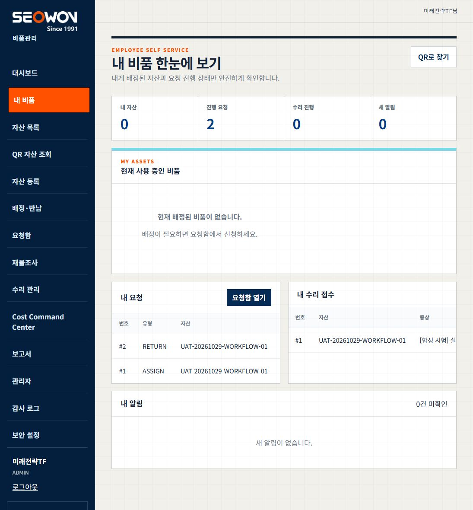

# Inventory 검사기·기존 반납 초안 복구

2026-10-29 KST. **승인된 복구와 기존 RETURN2 재시험·시험 배정 정리 PASS**. 전체 제품 보안/운영 인수 완료는 아니며 P7은7/8 유지한다.

## 7범주 완료 체크리스트

- [x] 승인/기준선: Inventory 검사기 경로·bridge18766 단독 재시작, 기존 초안 재시험/시험 정리 승인. 이어 사용자 추가 승인으로 frontend 최소 수정·재배포만 포함했다. 기존 dirty5개 보존.
- [x] 경로/서명: Microsoft 서명 Valid, 현재 버전4.18.26100.4, 합성 PNG 직접 scan 종료0. 고정 구버전 경로를 CurrentVersion 경로로1필드만 수정.
- [x] 단독 재기동: task/action/프로세스 명령·시작시각·listener11460 일치 후 해당 task만 stop/start, 새 PID101896. 보호 서비스는 변경하지 않음.
- [x] 최소 frontend/검사: 기존 RETURN draft ID를 유지하는 재업로드/제출 경로, 실패 시 지속 오류·중복 클릭·계정 변경 차단. 단위/캐시/이미지 포함/CI 검증.
- [x] 배포/브라우저: CI 동일SHA frontend만 반영, backend/DB ID 보존. 기존 초안 #2의 동일 PNG 업로드201·제출200 및 기존 payload 보존.
- [x] 독립 승인/정리: UAT ADMIN5 승인, 배정1 ENDED·반납1·사진1. 자산10 DISPOSED/비활성, 활성 배정0·DRAFT/SUBMITTED0, 수리1 CANCELLED·비용이벤트0.
- [x] 보존/인계: 회사13계정/권한13건과 기존25개 업무/설정 테이블 지문 일치. 사람/기계 증거·기능/스킬·Git 복구 체크포인트와 남은 위험 기록.

## 변경 범위와 실제 결과

기준 HEAD `de43864752cfbf14ad90edc9c34fa86717493409`, 코드 후보 `19813c7777904892ce4eb5f04453cf57765e6807`다. [GitHub quality40833770349](https://github.com/visionlab-coder/sqcm-i-inventory-system/actions/runs/40833770349)의 unit/three-tier-integration이 동일 후보에서 SUCCESS다. `npm.cmd run check` 종료0: 구문509·총1059 단위 중1051 PASS/8 SKIP/0 FAIL. 새 복구7건을 포함한 집중14 PASS, Compose/릴리스6 PASS, UI47 PASS, 프롬프트 strict8/8·경고0. Docker COPY 누락은 기존 이미지 계약시험이 먼저 실패시켜 수정했고 배포 전에 green을 확인했다.

런타임 config `D:\seowon_runtime\sqcmi-inventory-ai\config\bridge.json`의 scanner 실행파일만 `C:\ProgramData\Microsoft\Windows Defender\Platform\CurrentVersion\MpCmdRun.exe`로 변경했다. SHA256 `EADB987D2174F22715F36E5C2C9F5B25AE3A6CF82425E963D0270534F0CE7AE4`, 서명자 Microsoft Windows Publisher·Valid. 원본은 같은 보호 위치의 `bridge.before-defender-path-20261029.json`에 create-only로 보존했고 config 전체 비교에서 이1필드 외 동일이다. 편집 후 ACL SDDL 차이를 확인해 백업 ACL을 복원했고 최종 완전 일치했다. 원본 백업은 삭제된 과거 경로를 포함하는 역사 자료이지 정상 검사기로 검증한 rollback 후보가 아니다.

exact `SQCMI-Inventory-AI-Bridge` task만 stop/start했다. 새 Node 프로세스는 최초20초 listener 대기 한도를 넘었지만 실제로 살아 있었고, 로딩 진단 후 **같은 PID101896**이18766을 열었다. 무한 재기동·대체 runtime 설치·다른 프로세스 종료는 하지 않았다. source/bearer file/Secret/계정/Task action·principal·trigger는 변경하지 않았다. backend에서 실제 합성 PNG를 `/security/scan`으로 검사해clean, engine4.18.26100.4/signature1.463.16.0을 확인했다. 기존 unknown/infected fail-closed 코드는 그대로다.

추가 승인된 frontend는 기존 ‘내 요청’의 소유 RETURN DRAFT에만 **반납 사진 재업로드**를 표시한다. 대화상자에서 초안번호 확인→JPEG/PNG 선택→기존 초안 사진 재업로드·제출이다. 신규 요청 생성 endpoint를 호출하지 않고 원래 반납 상태·메모·부속품을 변경하지 않는다. 업로드 실패 시 제출을 하지 않으며, 성공한 업로드 뒤 제출만 실패하면 동일 사진으로 제출만 재시도한다. 오류는 modal 내부에 지속 표시하고 중복 클릭은 한 작업을 공유한다. 계정 변경 시 후속 제출을 막으며 서버의 소유자/CSRF/사진 검사를 우회하지 않는다. 닫기는 화면만 닫는 동작으로 초안 취소 UI를 추가한 것은 아니다.

## frontend만 반영

- frontend: `sqcm-r5-frontend:sha-19813c7777904892ce4eb5f04453cf57765e6807`, image inspect ID `sha256:5554bcbeaf3b0ebe6e1da2e55682238d2ed64b320d30006a8f72df33af4d9f82`.
- backend: 기존 `sqcm-r5-backend:sha-e0d2b554b13995718127a2a25c91bb146865af8b`, container `97de674c406f0509db1a9796c0e5397583aa96e89179ff4d32c8fa1bcea52ee3` 불변.
- database: container `21cd02e609acdceed47e0aa84aefdcc37149c4b2a6c1998a3ac9d49e93f64a65` 불변, migration0·seed0.
- `compose.ai-production.yaml`의 optional `FRONTEND_RELEASE_TAG`로 frontend를 분리 고정했다. 공용 RELEASE_TAG는 e0d2b55 그대로다. runtime env의 Secret 값은 바꾸지 않았고 상속 차단/허용된 사용자1개 규칙·예상 외 Allow0을 확인했다.
- config --quiet 및 실제 images 출력에서 backend e0/frontend19813/DB postgres16 일치. `up -d --no-deps --no-build --wait --wait-timeout 60 frontend` 종료0. rollback 경로는 기존 frontend e0 이미지 override로 준비했으나 **실제 rollback NOT_RUN**이다.
- HTTPS smoke 종료0: health200·api health200·readiness200·익명items401·공식로고200. Compose3 healthy, frontend loopback3300, backend/database host port0.

## 실제 기존 초안 재시험·정리

| 단계 | 실제 관찰 | 판정 |
|---|---|---|
| 기존 초안 선택 | 내 비품→내 요청 RETURN #2 DRAFT→‘반납 사진 재업로드’, modal 제목 #2 일치 | PASS 브라우저 |
| 동일 사진 재업로드 | 기존 합성 PNG1061bytes, `/requests/2/return-photo`201·12773.7ms | PASS 브라우저/API |
| 기존 요청 제출 | `/requests/2/action`200, #2 SUBMITTED. 총 요청2건·RETURN1건 유지 | PASS 브라우저/API/DB |
| 독립 승인 | 기존 UAT ADMIN5의 승인200, #2 APPROVED·원래 GOOD/메모/부속품 일치 | PASS API/DB |
| 반납 재조회 | 브라우저 내 자산0·현재 배정 비품 없음, 요청2 APPROVED | PASS 브라우저 |
| 배정·사진 | assignment1 ENDED·ended_at 존재, 반납1·사진1, ACTIVE POSTGRES 파일·checksum 일치 | PASS DB |
| 시험 정리 | 정상 상태 전이 RETURNED→DISPOSE_PENDING→DISPOSED, 자산10 비활성·취득가0·배정0 | PASS API/브라우저/DB |

브라우저 승인 버튼 자체를 검사한 것은 아니다. 승인·정리는 별도 UAT API, 사용자 재업로드/제출과 결과 조회는 실제 브라우저다. 초안재생성0·새RETURN0·파괴삭제0·실수리/지급0이다. 사진은 합성 시험 증빙으로 감사 보존한다. UI 대기 도구가 진행 중인 업로드를 일찍 timeout으로 보고한1회에는 재클릭하지 않고 실제201/200과 기존 ID를 관찰했다.

`--approve RETURN`, `--finalize`, `--verify` 모두 종료0/PASS. 마지막 verify는 DISPOSED·비활성/배정ENDED/반납1/사진1/수리CANCELLED/비용이벤트0 및 전체 보존을 검사했다. 정상 반납을 우회하는 SQL 쓰기는0이다. 회사13계정과 권한13건, 기존25개 업무/설정 테이블의 canonical snapshot SHA256 전후 모두 `711bafff78ed91177b9f9271941031c77ce837612c7efa31c3b5934f7fa053be`. 제외는 새 시험 자산10과 그 연결 기록뿐이며 이전 시험 자산8/9도 불변이다.

[시험 자산 폐기·배정 종료 상세](../screenshots/scanner-return-recovery-20261029/cleaned-detail.png). 승인 이력2건은 남겨 감사 추적을 보존한다.

## 보호 서비스·남은 위험

LM Studio1234/PID31896·Ollama11434/PID95224·Inventory runtime18767/PID112664 및 cloudflared PID23340/75468·시작시각은 전후 동일하다. 18765 listener는 전후 모두 없었으며 이 작업에서 중단하지 않았다. Inventory/SQCM-i tunnel 연결 각4·공개200·SAFE-LINK301을 확인했다. SQCM-i37봇에 명령·메시지·재시작을 보내지 않았고 모든 봇 개별 E2E를 검사했다고 주장하지 않는다.

WF-01의 이번 검사 경로 장애와 WF-03의 **기존 초안 재업로드/지속 오류 경로**는 해결했다. 최초 새 반납 생성 dialog의 일반 오류 UX·취소 흐름 전체 개선은 범위 밖이다. **WF-02: APPROVED 요청2개도 ‘진행 요청2’로 집계하는 표시 문제는 미수정**이다. 이는 활성 배정/미제출 초안이 남았다는 뜻이 아니며 DB상 둘 다0이다. 이를 숨기려고 요청을 SQL로 COMPLETED로 바꾸지 않았다.

빌드의 기존 dependency 감사에서 **Critical1/High3/Moderate1**을 발견했다: [proxy-addr Critical](https://github.com/advisories/GHSA-jqcg-44mw-7w3h), [body-parser High](https://github.com/advisories/GHSA-27r3-jxmh-p828), [brace-expansion High](https://github.com/advisories/GHSA-q2hr-2g5m-vwhr), [sharp High](https://github.com/advisories/GHSA-wq5f-xc86-pv6w), [qs Moderate](https://github.com/advisories/GHSA-6pq8-jhm2-2vcw). `npm audit --json` 실제 종료1의 registry 결과이며 구체적인 운영 악용 가능성 판정은 별도다. package.json/lock diff0, browser bundle metafile44inputs에서5패키지 포함false이며 새 frontend 코드도 외부 라이브러리를 추가하지 않았다. backend는 승인 범위대로 미변경이다. 따라서 이 작업을 무취약 판정으로 승격하지 않고 **별도 backend 의존성 보안 패치·검증·배포 승인 Gate**로 남긴다. npm audit fix/force·전역 업데이트는 실행하지 않았다.

기능/스킬 scoped 영향 IMPACT_PLANNED·실제 조작/CI 증거를 연결했다. 공용 quick_validate는 기존 Python PyYAML 미설치로 BLOCKED이고 frontmatter는 수동 검사했다. 전체 등록부의 별도 비표준 상태값은 본 기능 통과로 덮지 않았다. 현재 상태·기계 증거·exact allowlist 완료 문서를 후속 checkpoint로 commit/push하며 새 문서 커밋과 실제 배포 코드19813c7을 구분한다. P7 전체 상태는 변경하지 않는다.
